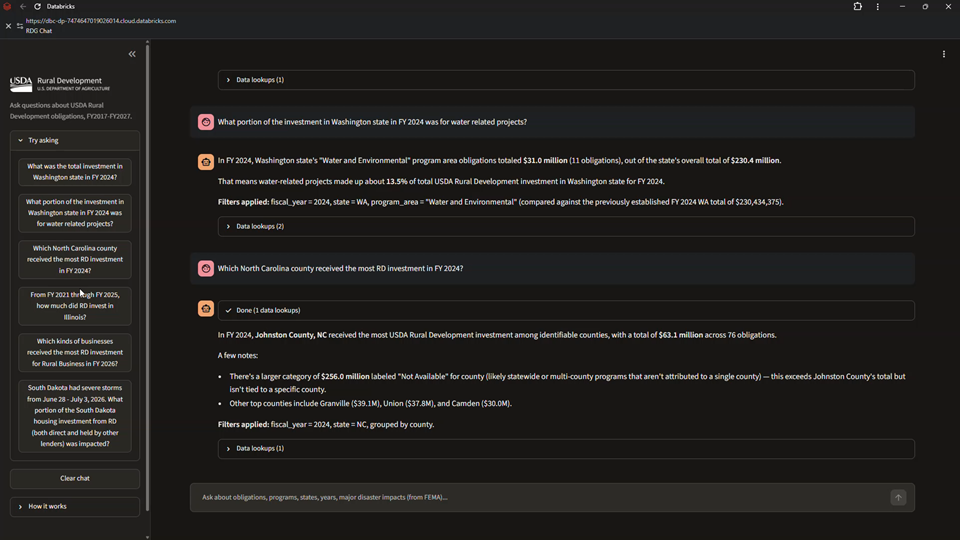

# Rural Data Gateway MCP

This repository is a read-only prototype for exploring Rural Development (RD)
investment data in Databricks. Its main workflow lets a user ask questions in
plain language, have a model select from bounded MCP tools, and inspect results
from the RD obligations data. The MCP server can also combine obligation data
with FEMA disaster declarations for a limited geographic exposure analysis.

The project has two distinct MCP interfaces: an application-specific server for
the PFD Obligations chat demo, and a general-purpose catalog browser for MCP
clients. A small REST API is included to support testing; it is not the primary
user interface.

## What It Can Answer

The chat demo is designed for questions about investment totals, breakdowns,
rankings, and comparisons across fiscal years, geographies, and programs. Example
questions include:

- How much did RD invest in Washington in FY 2024?
- What share of Washington's FY 2024 investment was for water-related projects?
- Which North Carolina county received the most investment in FY 2024?
- How much did RD invest in Illinois from FY 2021 through FY 2025?
- Which business sectors received the most investment in FY 2026?
- What share of South Dakota housing investment was in counties designated for
  a particular FEMA disaster?

Results depend on the source data and the choices made to interpret a question.
Obligation amounts are not outstanding loan balances. The FEMA example is a
historical geographic exposure measure, not an estimate of current debt,
physical damage, or actual loss. See the
[evaluation protocol](presentation_materials/evaluation-protocol.md) for the
reference calculations and limitations.

## See the Demo

[](https://raw.githubusercontent.com/gsa-mcp-hackathon/mcp_rdg_submission/main/assets/mcp_demo.mp4)


## Repository Map

| Path | Purpose |
| --- | --- |
| [mcp_server/](mcp_server/README.md) | Databricks App MCP server for PFD Obligations queries, FEMA lookups, and exposure analysis |
| [chat_app/](chat_app/) | Streamlit chat interface and model tool-calling loop for the PFD Obligations MCP server |
| [src/mcp_rdg/](src/mcp_rdg/) | Separate stdio MCP server for catalog, schema, and table discovery and bounded previews |
| [api/](api/README.md) | Read-only FastAPI service used to support MCP testing; not currently deployed |
| [tests/](tests/) | Automated regression tests for the MCP apps, chat transport, and general catalog browser |
| [example_tests.ipynb](example_tests.ipynb) | Notebook reference calculations for the representative investment questions |
| [presentation_materials/](presentation_materials/) | Evaluation notes and presentation materials |
| [scripts/](scripts/) | Windows scripts for starting the local MCP server and chat app |

## Run the Chat Demo Locally

The local chat app runs on your computer, while SQL queries and model inference
run in Databricks. You need Python 3.10 or newer, network access to the
workspace, a Databricks CLI login, and permissions for the SQL warehouse, source
table, and model endpoint. FEMA-related questions also call the public OpenFEMA
API.

In PowerShell, from the repository root, create an environment and install the
chat and MCP app dependencies:

```powershell
python -m venv .venv
.\.venv\Scripts\python.exe -m pip install -e . -r mcp_server/requirements.txt -r chat_app/requirements.txt
```

Install the standalone Databricks CLI and sign in to the workspace. The launcher
expects the CLI on `PATH` or at `$env:USERPROFILE\databricks-cli\databricks.exe`.
For example:

```powershell
$env:DATABRICKS_HOST = 'https://<your-workspace-host>'
$env:DATABRICKS_WAREHOUSE_ID = '<your-warehouse-id>'
& "$env:USERPROFILE\databricks-cli\databricks.exe" auth login --host $env:DATABRICKS_HOST --profile rdg-local
```

Set these variables in each PowerShell window before starting a service, or use
the combined launcher below to inherit them in both child windows.
Start each service in its own PowerShell window:

```powershell
.\scripts\start-local.ps1 -Service mcp
```

```powershell
.\scripts\start-local.ps1 -Service chat
```

Or start both windows with one command:

```powershell
.\scripts\start-local-all.ps1
```

Open <http://127.0.0.1:8501> to use chat. The MCP health check is at
<http://127.0.0.1:8000/> and the protocol endpoint is `/mcp`. Stop each service
with Ctrl+C in its PowerShell window.

The scripts require `DATABRICKS_HOST` and `DATABRICKS_WAREHOUSE_ID` and default to
profile `rdg-local` and serving endpoint `databricks-claude-sonnet-5`. Override these with
`-Profile`, `-WorkspaceHost`, `-WarehouseId`, or `-ServingEndpoint`. If a port
is occupied, use `-McpPort` on both service commands and `-ChatPort` on the chat
command. The local identity needs `CAN_USE` on the warehouse, `USE CATALOG`,
`USE SCHEMA`, and `SELECT` on `rd_edapt.analytics_bronze.pfd_obligations`, plus
`CAN_QUERY` on the serving endpoint.

Both local services bind to `127.0.0.1` and have no incoming authentication.
Do not expose them to a network. The local MCP connection does not send
Databricks credentials; SQL and model requests authenticate using the local
Databricks CLI profile. A successful health check only confirms that the MCP
server is running; ask a data question to verify the complete path.

## Deploy the Databricks Apps

The hosted version uses two apps. The MCP server authenticates to Databricks as
its app service principal and exposes the `/mcp` endpoint. The chat app calls
that MCP endpoint and a Databricks model serving endpoint. Deploy the MCP app
first:

```bash
databricks apps deploy "$MCP_APP_NAME" --source-code-path /Workspace/<repo-path>/mcp_server
databricks apps deploy "$CHAT_APP_NAME" --source-code-path /Workspace/<repo-path>/chat_app
```

Set `MCP_APP_NAME` and `CHAT_APP_NAME` to your app names privately and replace
`<repo-path>` with the Git folder path in the Databricks workspace.
Before deploying chat, store the full hosted MCP endpoint URL (including `/mcp`)
in a Databricks secret. Add that secret as a chat app resource with the key
`mcp-server-url` and grant the app service principal permission to read it.
The chat manifest maps this resource to `MCP_SERVER_URL`; it contains no fixed URL.
Also add the model serving endpoint resource with key `serving-endpoint`.
Each app has its own `app.yaml` and `requirements.txt`. The MCP app needs
`CAN_USE` on its SQL warehouse and `SELECT` on the obligations table. The chat
app needs `CAN_QUERY` on the serving endpoint and `CAN_USE` on the MCP app.
Hosted apps use Databricks app service principals rather than personal access
tokens. See [mcp_server/README.md](mcp_server/README.md) for server modules and
local checks.

<!-- delete me
## General Catalog Browser

`src/mcp_rdg/` is a separate stdio MCP server for clients such as Claude Desktop
or VS Code. It can browse catalogs available to the configured Databricks
identity. Its tools list catalogs, schemas, and tables; describe a table; and
preview a bounded number of rows. It does not expose arbitrary SQL or mutation
tools.

Install it from the repository root (Python 3.10 or newer):

```bash
python -m venv .venv
source .venv/bin/activate
python -m pip install -e .
```

Configure the Databricks host, SQL warehouse HTTP path, and token in the client
environment:

```bash
export DATABRICKS_HOST="https://your-workspace.cloud.databricks.com"
export DATABRICKS_HTTP_PATH="/sql/1.0/warehouses/..."
export DATABRICKS_TOKEN="..."
```

Then run `mcp-rdg`. The MCP client configuration should invoke the installed
`mcp-rdg` executable and provide those environment variables; store credentials
in a secret manager rather than in source control. Preview limits can be
configured with `MCP_RDG_MAX_PREVIEW_ROWS` (default 100, maximum 1000).

-->

## Tests and Evaluation

From the repository root, install the app dependencies and run the automated
suite:

```bash
python -m pip install -e . -r mcp_server/requirements.txt -r chat_app/requirements.txt
python -m unittest discover -s tests -v
```

The automated tests use mocks or fakes for Databricks, FEMA, and local MCP
transport. They check implementation behavior, not live service availability
or natural-language answer quality. The six representative chat questions were
manually compared with notebook reference calculations; no benchmark score is
claimed. Details are in the
[evaluation protocol](presentation_materials/evaluation-protocol.md).

## REST API

`api/` contains a read-only FastAPI service over the obligations and commercial
guaranteed-loans tables. It supports the MCP test work and is not currently
deployed. See [api/README.md](api/README.md) for endpoints, local use, and
deployment notes.

## Data and Credentials

The main MCP app reads a version of the same data that can be retrieved via data
download on the Rural Data Gateway, stored within the RD Dev Environment at
 `rd_edapt.analytics_bronze.pfd_obligations`. The FEMA
lookups use the public
[OpenFEMA Disaster Declarations Summaries v2 dataset](https://www.fema.gov/openfema-data-page/disaster-declarations-summaries-v2).
Keep virtual environments such as `.venv` out of source control, and never
commit `.env` files, Databricks tokens, or other credentials.

See [.env.example](.env.example) for supported environment variables. It is a
reference template, not an automatically loaded configuration file. Set values
in your shell, a private environment file loaded by your tooling, or Databricks
app resources. Never put credentials in command-line arguments or notebook cells.
The cluster notebook requires `DATABRICKS_WAREHOUSE_ID`,
`DATABRICKS_SECRET_SCOPE`, and `DATABRICKS_TOKEN_SECRET_KEY` in its compute
environment. It discovers workspace and cluster details from runtime metadata
and retrieves the SQL token from the configured secret reference.

Before sharing notebooks, clear all outputs; runtime links and logs can identify
your infrastructure. Ignore rules do not remove files already tracked by Git.
Sanitizing current files does not remove values from old commits, forks, or
shared copies. Review history before publishing, and rotate any credentials
that were ever committed or shared. Workspace and warehouse IDs are identifiers,
not authentication credentials.

## Rendering the presentation

The slide source is `presentation_materials/deck.md`. Install the [Quarto CLI](https://quarto.org/docs/get-started/) to render or preview it.

From the repository root, render the slides with:

```powershell
quarto render presentation_materials/deck.md
```

This creates `presentation_materials/deck.html` and its `deck_files/` dependencies. Open `deck.html` in a browser to view the presentation. These generated files are excluded from Git, so render them locally after cloning or pulling changes.

For a live preview that refreshes as the source changes, run:

```powershell
quarto preview presentation_materials/deck.md
```

Open the local URL Quarto prints in your browser and stop the preview with `Ctrl+C`.
