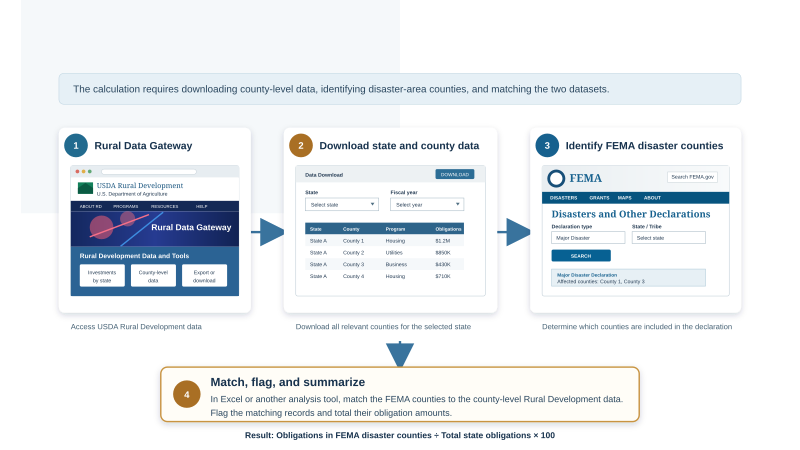
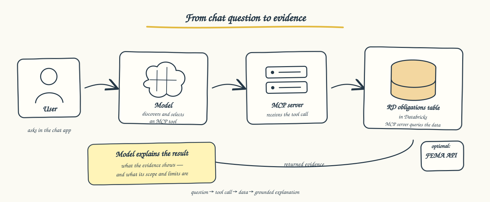
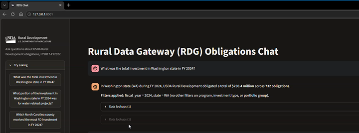
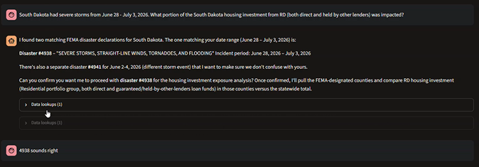
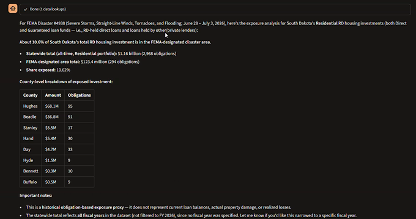

## Explore RD investment by asking simple questions

> How much did Rural Development invest in Washington in FY 2024?

> South Dakota had severe storms in summer 2026. What share of FY 2026 residential loan obligations was in the FEMA-designated areas?

**Rural Data Gateway MCP** turns common investment questions into bounded, inspectable data queries.

**Recorded demo:** Demo was recorded 19 NOVEMBER 2026, served locally - the large video file is not in this repository

## The challenge

The Rural Data Gateway presents Rural Development investment information through public dashboards. Questions outside a predefined view, such as comparing totals across years, geographies, or program categories, can require users to download data and do additional analysis themselves.

- The dashboard supports its predefined views; a new comparison can require a separate workflow.
- Users need to select consistent fiscal-year, geography, and program filters.
- A useful answer should show its scope and distinguish obligation amounts from other measures of investment.

## Visual Representation of the challenge

We want to make this simpler for users

## The solution

The chat assistant uses read-only MCP tools to retrieve Rural Development obligation data and summarizes the results in ordinary language. The primary workflow covers totals, breakdowns, rankings, and multi-year comparisons. FEMA disaster analysis is an optional cross-source extension.

**The prototype can:**

- Summarize obligations by fiscal year, state, program, county, and other supported categories.
- Discover valid filter values and retrieve paged row-level detail when needed.
- Return totals and applied scope so users can inspect how a result was formed.
- Optionally connect FEMA declarations and designated counties to a bounded exposure comparison.

**Scope:** This is a proof of concept for exploration, not an official reporting system or a decision tool.

## How a question becomes an answer

**Optional FEMA path:** For disaster questions, MCP tools also search OpenFEMA and retrieve designated areas before comparing county and statewide obligations.

**Local demo:** Chat and MCP run on loopback; SQL and model requests still go to Databricks.

**Hosted path:** Databricks Apps, the model endpoint, MCP server, and SQL warehouse.

## Tools designed around user goals

The server offers goal-oriented actions rather than arbitrary SQL:

| User goal | MCP action |
| --- | --- |
| Understand the table and discover valid categories | `describe_obligations_table`, `list_distinct_values` |
| Compare totals, groupings, and rankings | `summarize_obligations` and predefined summaries |
| Find and inspect individual records | `search_obligations`, `get_obligation` |
| Optional: identify a disaster and designated areas | `search_fema_disasters`, `get_fema_designated_areas` |
| Optional: compare obligations in designated areas | `assess_investment_exposure_to_fema_areas` |

Filters and aggregation dimensions are constrained in code, SQL filter values are parameterized, and row search is paged with a per-call limit. The server does not expose arbitrary SQL or data modification tools.

Tool arguments use typed function signatures with FastMCP. The agent is instructed to prefer summaries for totals and rankings, discover uncertain category values instead of guessing, state applied filters, and explain tool errors without inventing results.

## Primary demo: follow an everyday question

**Ask:** “How much did Rural Development invest in Washington in FY 2024?”

**The MCP server enables the agent to:**

1. Select the summary tool rather than requesting arbitrary SQL or individual rows.
2. Apply the state and fiscal-year scope.
3. Return the obligation total and any relevant count or source context.
4. State the filters used.

{width=700}

**Interpretation:** The agent uses just one tool call to return the correct result.

## Extension: connect investment data to FEMA

For a more complex disaster-related question, the assistant can search FEMA declarations, inspect designated counties, and compare qualifying residential loan obligations in those counties with the statewide total for the same fiscal year and loan scope. This demonstrates joining obligations data with another federal data set, a common need among users.

1. Search by state, title text, and incident-date bounds; confirm the declaration number.
2. Use the confirmed declaration number to identify disater counties (or full state).
3. Match FEMA-designated counties to RD county FIPS codes.
4. Compare designated-area and statewide totals using consistent filters.

$$
	ext{Share} = \frac{\text{qualifying obligations in designated counties}}{\text{qualifying obligations statewide}}
$$

This is an optional exploration example. Historical obligations are an exposure proxy, not current balances, unpaid principal, physical damage, or actual loss.

## Demo result: FEMA related query

::: {layout-ncol=2}

**Interpretation:** The agent confirms the disaster number and uses just one tool call to return exposure.

:::

## Evaluation: how we checked the workflow

**Manual functional comparison**

- Six representative questions covering state totals, program shares, county rankings, multi-year totals, business sectors, and one optional FEMA-area exposure case.
- Compared chat answers with separately written reference calculations in `example_tests.ipynb`, querying the same source data and using OpenFEMA for designated areas.
- Manual evaluation; no benchmark score or exact accuracy percentage was recorded.

**Automated regression tests**

- 21 test methods passed on November 19, 2026.
- Checks cover tool registration and selected schemas, query filters and paging, FEMA/exposure calculations, result serialization, local transport restrictions, and date/fiscal-year boundaries.
- Databricks, FEMA, and local transport are mocked or faked in these tests.

## Why this matters to the mission

The prototype demonstrates a way to make Rural Development obligation data easier to explore through natural-language questions about investment totals, programs, time periods, and geography. The FEMA comparison extends that core workflow to one cross-source question.

The answer carries its scope, source totals, and limitations so that users can inspect what was compared. It supports exploration and oversight; it does not replace official reporting, loan-balance analysis, damage assessment, or emergency-response decisions.

**Next steps (if prototype approved for development):**

- Include public facing commercial loans data
- Build automated testing, with expanded scope
- Conduct internal user testing

## Sources and reference

- Rural Data Gateway: <https://www.rd.usda.gov/rural-data-gateway>
- OpenFEMA API: <https://www.fema.gov/about/openfema/api>
- Evaluation method and limitations: `evaluation-protocol.md`
- Reference calculations: `example_tests.ipynb`
- MCP implementation and automated checks: `mcp_server/`, `tests/`

**disclaimer**: _Bob Dinterman and Jess Chandler work in Rural Development's Innovation Center, this hackathon MCP is the work of the authors and is only a proof of concept. It is not intended to represent the USDA's official position on data retrieval or product use, nor endorse any product or method. Neither Bob nor Jess have contracting authority._
